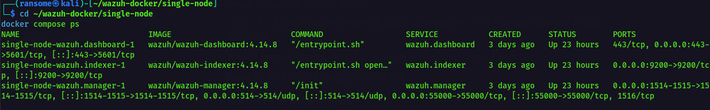
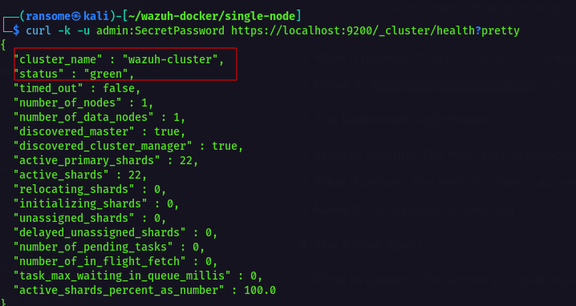
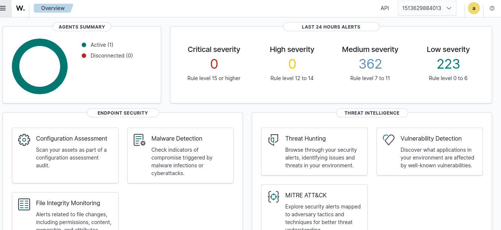
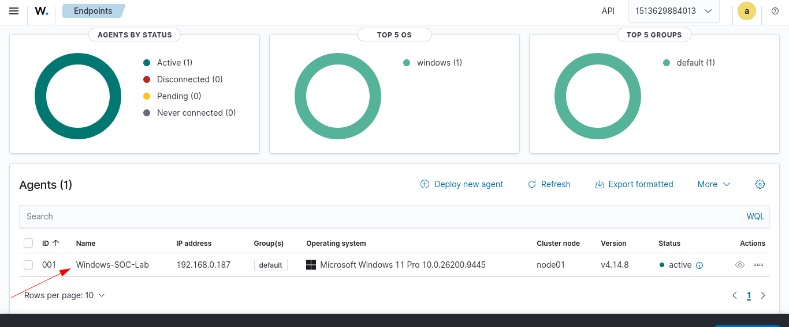
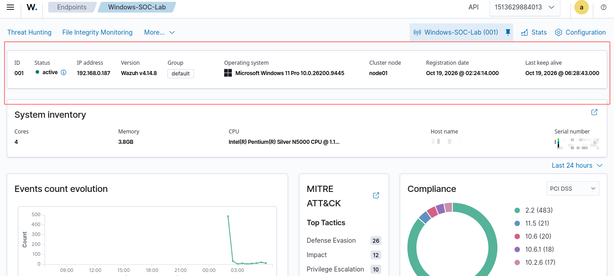
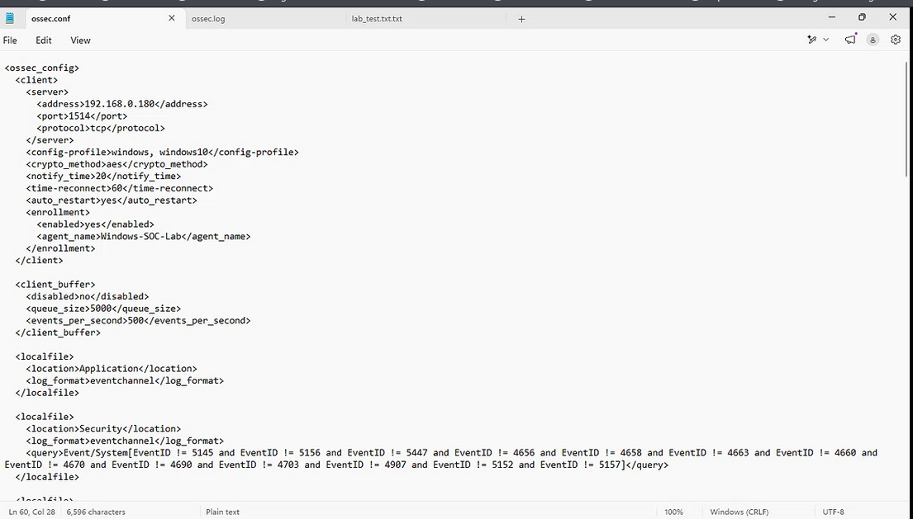
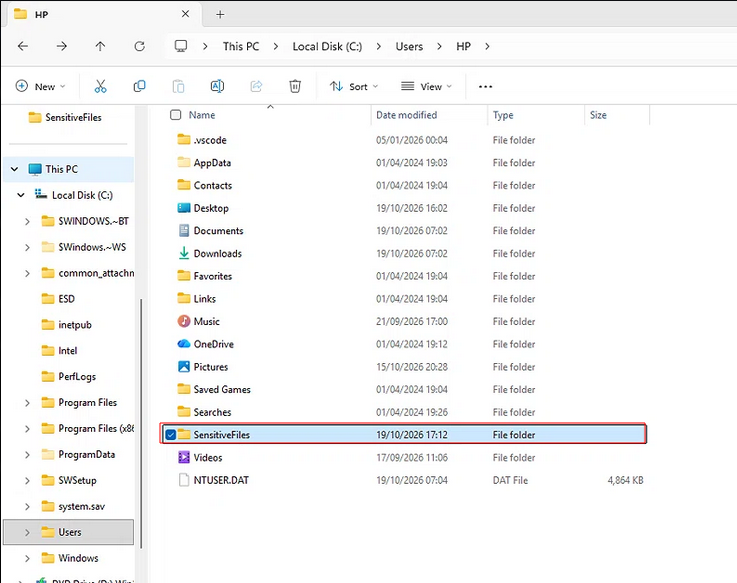
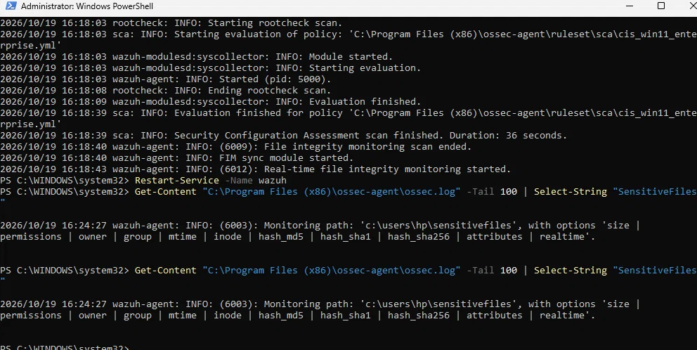
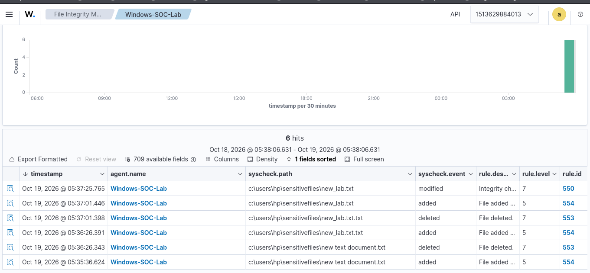
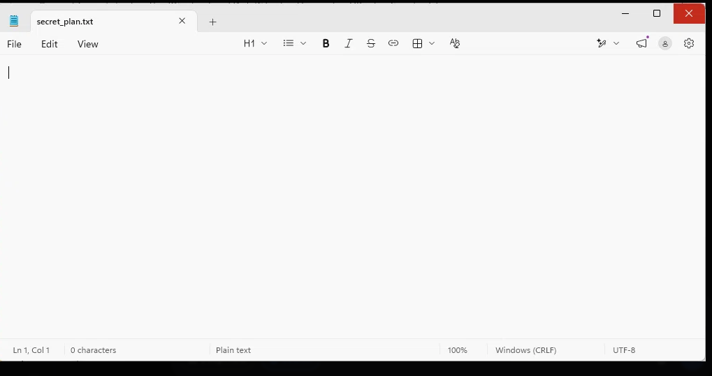

# 1. Executive Summary

This report documents the successful deployment, configuration, and validation of a centralized Security Information and Event Management (SIEM) environment using Wazuh. The objective of this lab was to establish visibility into endpoint file changes by deploying a Wazuh Manager (hosted in Docker on Kali Linux) and a Wazuh Agent (installed on a Windows 11 endpoint). 

File Integrity Monitoring (FIM) was successfully configured using real-time directory monitoring (`realtime="yes"`). By simulating unauthorized file activity (creation, modification, and deletion of `secret_plan.txt`), the environment demonstrated its capability to ingest endpoint telemetry, generate syscheck alerts, and display actionable intelligence on the central Wazuh Dashboard. This successfully establishes the foundational SOC capability required for detecting unauthorized changes in a corporate environment.

# 2. Incident Timeline (Lab Execution)

*   **Phase 1: Manager Deployment:** Wazuh Manager, Indexer, and Dashboard were deployed via Docker Compose on Kali Linux. Kernel parameters were tuned (`vm.max_map_count=262144`) and certificates generated.
*   **Phase 2: Agent Enrollment:** The Windows 11 endpoint was configured to communicate with the Manager over TCP port 1514. The Agent successfully authenticated and registered as `Windows-SOC-Lab`.
*   **Phase 3: FIM Configuration:** The agent's `ossec.conf` was modified to monitor `C:\Users\HP\SensitiveFiles` in real-time.
*   **Phase 4: Attack Simulation:** A test file (`secret_plan.txt`) was created, modified, and deleted within the monitored directory.
*   **Phase 5: Alert Generation:** The Wazuh Manager ingested the syscheck events and generated rules 550 (Modified), 553 (Deleted), and 554 (Added) in the dashboard.

# 3. Log & Network Analysis (Evidence)

### 3.1 Infrastructure & Agent Health
The Wazuh Manager environment was successfully containerized and verified. The Docker containers were healthy, and the Indexer cluster status was confirmed as "Green", ensuring the backend database was ready to ingest logs.





The Windows 11 endpoint successfully connected to the Manager. The dashboard confirms the agent is "Active" and communicating.




### 3.2 File Integrity Monitoring Configuration
The endpoint was configured to monitor a specific high-value directory. The `ossec.conf` was updated to include the real-time monitoring directive. 




Local telemetry on the Windows endpoint (`ossec.log`) confirmed that the Wazuh agent successfully parsed the XML configuration and activated the real-time file watcher for the target directory.



### 3.3 Alert Triage & Analysis
The test file (`secret_plan.txt`) was created and deleted. The Wazuh Dashboard immediately reflected the telemetry.




*Snippet of generated FIM telemetry:*
```json
{
  "agent.name": "Windows-SOC-Lab",
  "syscheck.path": "c:\\users\\hp\\sensitivefiles\\secret_plan.txt",
  "syscheck.event": "modified",
  "rule.level": 7,
  "rule.id": "550"
}
````
By drilling into the "Modified" alert, the SOC analyst can perform triage by observing the exact cryptographic hashes and file size differences before and after the event.

https://images/09_Modified_Alert_Checksums.png

# 4. Analysis Questions & Answers

1. Alert Triage: Find an alert where a file was modified. What specific details in the alert tell you what was changed about the file?
When expanding a Rule 550 (File Modified) alert, the syscheck block provides the specific forensic details of the change. The analyst must look at the md5_after, sha1_after, and sha256_after fields compared to the _before hashes. Additionally, the size_after field will display a different byte count than the size_before field. If the hash changes but the size remains identical, it indicates a stealthy content alteration (e.g., swapping a character in a configuration file).

2. False Positive Identification: In a corporate environment, which folders would generate too many FIM alerts to be useful?

    C:/Windows/Temp  (or user %TEMP% directories): Operating systems and applications constantly create, modify, and delete temporary files here during normal operation. Monitoring this would flood the SIEM with irrelevant noise.

    C:/Users/<User>/AppData/Local/Microsoft/Outlook (or browser cache folders): Applications like Outlook (.ost/.pst files) and web browsers constantly write to their cache and log files as the user works. This high-volume background noise would bury actual security incidents.

3. Proactive Defense: How could you use Wazuh's FIM capability to monitor for a specific ransomware behavior?
Ransomware typically executes rapid, mass encryption and deletion of files. A SOC team can configure Wazuh FIM to monitor critical data directories (e.g., D:/Company_Shares) with realtime="yes". The defense strategy would involve creating a custom correlation rule in Wazuh that triggers a Critical alert if more than 50 file modifications or deletions occur within a 1-minute window. This frequency anomaly indicates active encryption, allowing the SOC to trigger an automated Active Response to isolate the infected endpoint.

4. Tool Comparison: How does using a centralized tool like Wazuh for FIM provide an advantage over relying solely on built-in Windows features?
Windows Event Logs (like Event ID 4663) track file access locally. However, if an attacker (or ransomware) gains SYSTEM privileges, they can easily clear the local Event Logs to destroy evidence. Wazuh provides a centralized, off-host advantage: FIM alerts are streamed over an encrypted channel to the Wazuh Manager in real-time. Even if the Windows endpoint is completely destroyed, the cryptographic hashes, timestamps, and filenames of the unauthorized changes remain safely stored in the Wazuh Indexer for forensic analysis.

# 5. Blue Team Methodology & Tools

To effectively detect and respond to these types of endpoint events, a mature SOC relies on the following telemetry sources and tools:

   SIEM Platforms (Wazuh / Splunk / Microsoft Sentinel): Used to aggregate, correlate, and alert on logs from disparate sources. Wazuh serves as the core SIEM in this lab, utilizing OpenSearch to index FIM data.

   Windows Event Viewer & Advanced Audit Policy: Crucial for baseline forensics. Analysts monitor Event ID 4624 (Logon), 4663 (Attempt to access an object), and 4670 (Permissions on an object were changed) to track file access.

   Sysmon (System Monitor): A Windows system service and device driver that logs system activity to the Windows event log, providing high-fidelity file creation and process execution telemetry.

   Microsoft Defender for Endpoint (MDE): Provides EDR capabilities that can detect malicious process executions (e.g., scripts attempting to mass-encrypt files) before FIM even triggers.

   Network IDS (Zeek / Suricata): While FIM is host-based, network monitoring can detect the exfiltration of the modified files after they are compromised.

# 6. Remediation & Containment Plan

Based on the successful detection of endpoint file changes, the following containment and remediation steps are recommended for production environments:

   Automated Containment: Integrate Wazuh Active Response with host firewalls. If a Level 7+ FIM alert triggers repeatedly within a short timeframe, automatically isolate the endpoint from the network.

   Hash Blacklisting: Configure the Wazuh Manager to compare the hashes of modified files against threat intelligence feeds (like VirusTotal or MISP) to instantly flag known malware.

   Access Control Review: Restrict file permissions for the monitored SensitiveFiles directory. Ensure that only authorized service accounts or administrators have Write and Delete permissions, utilizing the Principle of Least Privilege.

   Log Retention & Backups: Ensure SIEM logs (specifically FIM and Windows Event logs) are retained for at least 90 days in immutable storage to comply with compliance frameworks and enable post-incident forensics.
